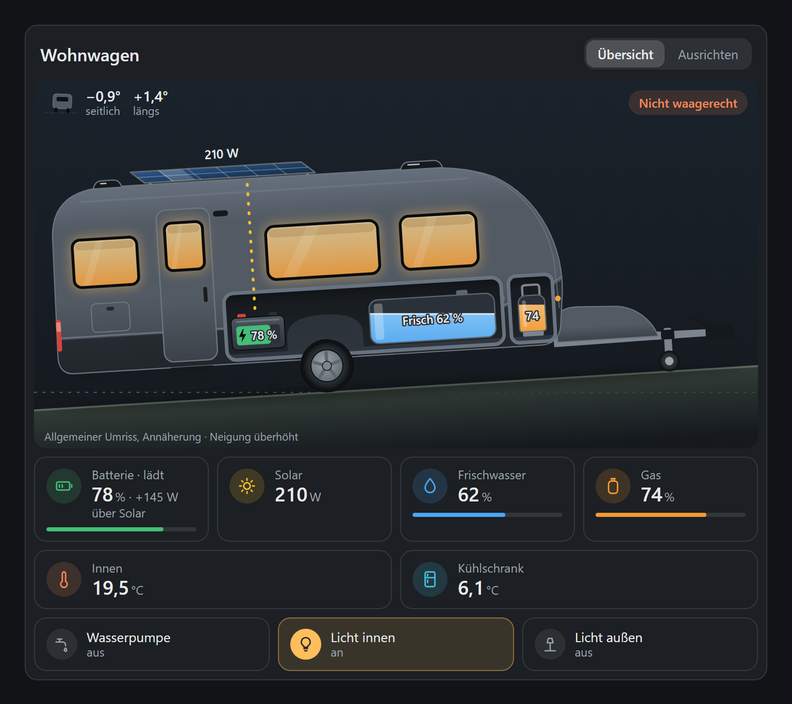
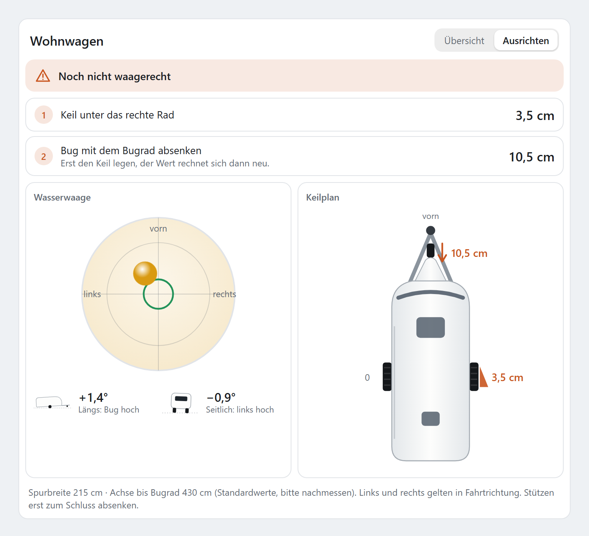
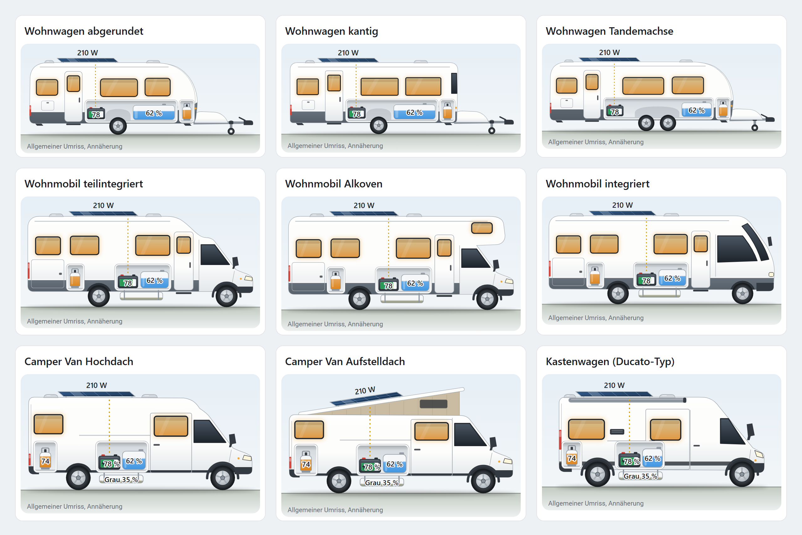

# Camper Card

Dashboard card for Home Assistant: a caravan, motorhome or camper van in side view with tanks, battery, solar and lights, plus levelling with chock heights. German and English. Works without internet. No integration needed, the card reads entities you already have.

*Deutsch:* Dashboard-Karte für Home Assistant: Wohnwagen, Wohnmobil oder Camper Van in der Seitenansicht mit Tanks, Batterie, Solar und Licht, dazu Ausrichten mit Keilhöhen. Deutsch und Englisch, funktioniert ohne Internet, braucht keine Integration.

> **Status: early test version (0.3.0).** Feedback is very welcome, please open an [issue](https://github.com/F30onAir/ha-camper-card/issues). Vehicle outlines are self-drawn generic approximations, not manufacturer drawings.

<p align="center"></p>

## Features

- Side view with 9 outlines: caravan (rounded, angular, twin axle), motorhome (semi-integrated, alcove, integrated), camper van (high roof, pop-up roof, panel van of the Ducato / Boxer / Jumper type)
- Fresh water, grey water (motorhome and van), one or two gas bottles, battery, solar, charger
- Temperatures inside, outside, fridge and freezer, inside humidity with a "too humid" hint
- Remaining battery time ("lasts approx. 10 h", "full in approx. 2 h") from charge, power and capacity
- Frost warning when there is water in a tank and it gets too cold
- Rename every tile in your own language, for example "Färskvatten" or "Gas left"
- Windows light up with the inside light, outside light, water pump or taps as a switch, plus up to 6 switches of your own (fridge, heater, boiler …)
- Charge source: solar, charger, both or unknown, derived from your sensors
- Levelling: spirit level from two tilt sensors, chock height per wheel, for caravans also the jockey wheel
- Sensors that are assigned but offline show "offline", unassigned parts are hidden
- Visual editor, light and dark theme, phone and tablet

## Sensors and switches

The card is only the display. It has no integration of its own and talks to no device directly. It reads entities that already exist in Home Assistant, no matter how they get there: Zigbee, Bluetooth, ESPHome, MQTT, Victron, Shelly and so on. Everything is optional. Start with one or two sensors, parts without an entity are hidden.

| Field | Entity | Value | Typical source |
|---|---|---|---|
| `battery` | sensor | % | state of charge from a BMS or battery monitor |
| `battery_power` | sensor | W, positive = charging | BMS or shunt |
| `solar` | sensor | W | solar charge controller |
| `charger` | switch | on/off | smart plug or relay in front of the mains charger |
| `charger_power` | sensor | W | power metering of that plug |
| `fresh`, `grey` (motorhome, van) | sensor | % | tank level sensor (ultrasonic, pressure, probes) |
| `gas` | sensor | % | gas bottle level sensor |
| `gas_availability` | any | – | raw sensor behind a gas template, shows "offline" instead of 0 % |
| `gas2`, `gas2_availability` | sensor, any | % | second gas bottle, shown as "Gas 1" and "Gas 2" |
| `temp_inside`, `temp_outside`, `temp_fridge`, `temp_freezer` | sensor | °C or °F | any temperature sensor |
| `humidity_inside` | sensor | % | any humidity sensor, shown with the inside temperature |
| `pump` | switch or light | on/off | water pump or taps, tap the card to switch |
| `light_inside`, `light_outside` | switch or light | on/off | lights, tap the card to switch |
| `switches:` (list) | switch, light, input_boolean, fan | on/off | up to 6 switches of your own, tap to switch |
| `pitch`, `roll` | sensor | ° (also %, rad, mrad) | tilt sensor, lengthwise and sideways |

Number fields also take `input_number` and `number`, switch fields also `input_boolean`. With helpers you can try the card before any hardware is installed.

**Tile names.** Every tile and switch can get your own label under `names:` (in the editor: "Tile names"), in any language. Empty means the default name. Status texts and the levelling instructions stay in English or German.

**Remaining battery time.** Set `battery_capacity` (Ah) and the card estimates from `battery` (%) and `battery_power` how long the battery lasts when discharging, or when it is full when charging. `battery_power` may be in W, kW or A (A works without conversion), `battery_voltage` defaults to 12.8 V. Below 5 W the card shows no time. It is an estimate based on the current power, a BMS with its own "time remaining" sensor may be more precise.

**Frost warning.** When a tank holds water (more than 2 %) and the temperature falls below `frost_temp` (default 3 °C), the tank tile says "Frost risk" and the tank in the side view gets a snowflake. Tanks inside the body use the inside temperature first, underfloor tanks the outside temperature first. Turn it off with `frost_warning: false`.

**Humidity.** `humidity_inside` appears below the inside temperature, or as its own tile without one. From `humidity_max` (default 70 %) the card shows "too humid".

**Your own switches.** Under `switches:` (in the editor: "More switches") you can add up to 6 entities, each with an optional `name` and `icon` (for example `mdi:fridge`). Without a name the card uses the name from Home Assistant.

**Charge source.** A BMS only measures the total at the battery. The card counts the battery as charging above 5 W and then looks at the sources: solar above 5 W means solar. The charger counts when its switch is on and its plug draws at least `charger_min_power` (default 10 W). If only one of the two is assigned, that one decides. The card shows solar, charger, both, or "unknown" if no source explains the charging.

**Tested in a real caravan:** LiFePO4 battery with Bluetooth BMS via [BMS BLE](https://github.com/patman15/BMS_BLE-HA) (HACS), gas bottle via the built-in Mopeka integration, fresh water via an E-Waterlevel Bluetooth sensor read by an ESP32 with [esphome-ewaterlevel](https://github.com/Fabian-Schmidt/esphome-ewaterlevel), taps via a Zigbee switch. Not tested yet: a real tilt sensor (levelling was checked with simulated values).

<details>
<summary>Tank or gas sensor reports mm or litres instead of %</summary>

Create a template sensor (Settings → Devices & services → Helpers → Template → Sensor), unit `%`, and assign it in the card. Example for a gas sensor in mm, set `full` to the reading of a full bottle:

```jinja


{{ [mm / full * 100, 100] | min | round(0) }}
```

Then set `gas_availability` to `sensor.gas_tank_level`, so the card shows "offline" instead of 0 % when the bottle sensor is out of range.

</details>

<details>
<summary>Tilt sensor with ESPHome (example, not tested yet)</summary>

An ESP32 with an MPU6050 board, mounted flat with the x axis in driving direction:

```yaml
i2c:
  sda: GPIO21
  scl: GPIO22

sensor:
  - platform: mpu6050
    address: 0x68
    update_interval: 500ms
    accel_x: { id: ax, internal: true }
    accel_y: { id: ay, internal: true }
    accel_z: { id: az, internal: true }
  - platform: template
    name: Tilt length
    unit_of_measurement: "°"
    accuracy_decimals: 1
    update_interval: 1s
    lambda: |-
      return atan2(id(ax).state, sqrt(id(ay).state * id(ay).state + id(az).state * id(az).state)) * 180 / M_PI;
    filters:
      - sliding_window_moving_average: { window_size: 10, send_every: 1 }
  - platform: template
    name: Tilt side
    unit_of_measurement: "°"
    accuracy_decimals: 1
    update_interval: 1s
    lambda: |-
      return atan2(id(ay).state, sqrt(id(ax).state * id(ax).state + id(az).state * id(az).state)) * 180 / M_PI;
    filters:
      - sliding_window_moving_average: { window_size: 10, send_every: 1 }
```

If a direction is reversed or the axes are swapped, fix it in the card editor (invert, swap axes), then press the zero-point button while the vehicle stands level.

</details>

*Deutsch:* Die Karte ist nur die Anzeige und bringt keine eigene Integration mit. Sie liest Entitäten, die schon in Home Assistant sind, egal ob über Zigbee, Bluetooth, ESPHome, MQTT oder Victron. Tanks, Gas und Batterie in %, Leistungen in W, Neigung in Grad. Alles ist optional, fehlende Teile werden ausgeblendet. Bis zu zwei Gasflaschen, jede Kachel lässt sich unter `names:` selbst benennen. Neu in 0.3: Temperatur außen und Gefrierfach, Luftfeuchte innen mit Hinweis „zu feucht“, Restlaufzeit der Batterie (mit `battery_capacity` in Ah), Frostwarnung für Tanks mit Wasser und bis zu sechs eigene Schalter unter `switches:`. Getestet im Wohnwagen mit Bluetooth-BMS (BMS BLE), Mopeka-Gassensor, E-Waterlevel über ESPHome und Zigbee-Schalter.

## Screenshots

Levelling: what to do first, spirit level and chock plan (light theme).

<p align="center"></p>

The 9 outlines, each with tanks, battery and solar. All are self-drawn approximations without logos.

<p align="center"></p>

The images are rendered from the real card with sample data (`docs/shots.html`).

## Installation (HACS / Marketplace)

From Home Assistant 2026.11 HACS is built in as the **Marketplace**, the steps stay the same. The card is not in the default catalog yet. Add it as a custom repository:

1. HACS or Marketplace → ⋮ (top right) → **Custom repositories**
2. Repository: `https://github.com/F30onAir/ha-camper-card`, type: **Dashboard**
3. Open **Camper Card** and download it
4. Reload the browser (in the companion app: reset the frontend cache in the app settings)
5. Edit a dashboard → **Add card** → **Camper Card**, then pick your entities in the editor

*Deutsch:* HACS bzw. ab Home Assistant 2026.11 Marketplace → ⋮ → **Benutzerdefinierte Repositories** → `https://github.com/F30onAir/ha-camper-card`, Typ **Dashboard** → **Camper Card** herunterladen → Browser neu laden → Dashboard bearbeiten → **Karte hinzufügen** → **Camper Card**.

## Example

```yaml
type: custom:camper-card
name: Wohnwagen
vehicle: caravan          # caravan | motorhome | van
outline: caravan_round    # caravan_round, caravan_box, caravan_tandem, mh_semi, mh_alcove, mh_integrated, van_high, van_popup, van_ducato
offline: grey             # grey | hide (assigned but offline)
battery_capacity: 100     # Ah, optional, shows the remaining time
battery_voltage: 12.8     # V, nominal voltage, default 12.8
frost_temp: 3             # °C, frost warning below (frost_warning: false turns it off)
humidity_max: 70          # %, "too humid" from here
entities:
  battery: sensor.battery_soc
  battery_power: sensor.battery_power      # W, positive = charging
  solar: sensor.solar_power
  charger: switch.charger                  # optional, shows the charger as a source
  charger_power: sensor.charger_plug_power
  fresh: sensor.fresh_water_percent
  grey: sensor.grey_water_percent          # motorhome and van only
  gas: sensor.gas_percent
  gas_availability: sensor.gas_raw_sensor  # shows "offline" instead of 0 % when this one is unavailable
  gas2: sensor.gas_bottle_2_percent        # optional second bottle
  temp_inside: sensor.inside_temperature
  humidity_inside: sensor.inside_humidity
  temp_outside: sensor.outside_temperature
  temp_fridge: sensor.fridge_temperature
  temp_freezer: sensor.freezer_temperature
  pump: switch.water_pump
  light_inside: light.inside
  light_outside: light.awning
  pitch: sensor.tilt_length                # degrees (also %, rad, mrad)
  roll: sensor.tilt_side
switches:                 # optional, up to 6
  - entity: switch.fridge
    name: Fridge
    icon: mdi:fridge
  - switch.water_heater   # short form, name from Home Assistant
names:                    # optional, any language, empty = default
  fresh: Färskvatten
  gas: Gas left
  gas2: Gas right
  pump: Taps
leveling:
  track: 215        # cm, wheel centre to wheel centre
  base: 430         # cm, caravan: axle to jockey wheel, motorhome/van: wheelbase
  max_wedge: 12     # cm, warn above
  steps: 3, 6, 9    # optional chock steps
  tolerance: 0.2    # degrees counted as level
```

Tank and battery sensors are expected in percent. Sign convention for tilt: `pitch > 0` means nose or front up, `roll > 0` means right side up (in driving direction). Use `invert_pitch`, `invert_roll`, `swap_axes` and the zero-point button in the editor to match your sensor.

## Support

If you like the card, you can support development with a voluntary coffee:

<a href="https://buymeacoffee.com/f30onair"></a>

## License

MIT, see [LICENSE](LICENSE).

## Development

No npm packages are needed. With Node.js 22 or newer:

```bash
npm run build   # writes dist/camper-card.js
npm test        # levelling maths, charge sources, config, editor mapping, build output
```

`test/harness.html` shows the built card with simulated Home Assistant data. Serve the project folder with any static web server and open that page.
